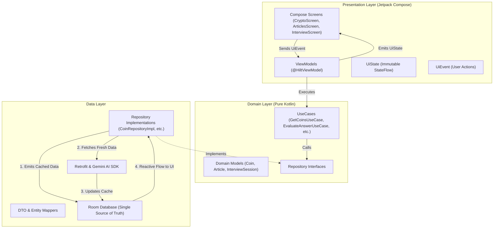

# 🚀 TechHub — Modern Clean Architecture Android Showcase

[](https://kotlinlang.org)
[](https://developer.android.com/jetpack/compose)
[]()
[]()
[](https://ai.google.dev/)
[](https://github.com/memayank4u/techhub/actions)

A production-grade Android application designed as an **industry showcase of modern Android development**. Demonstrates **Clean Architecture**, **Offline-First Single Source of Truth (SSOT)**, **Unidirectional Data Flow (UDF)**, **100% Jetpack Compose**, **Type-Safe Navigation**, and **Google Gemini Generative AI**.

---

## 📱 Features

1. **📊 Crypto Markets (CoinGecko API)**
   - Real-time market rankings, prices, 24h highs/lows, and percentage changes.
   - **Offline-First Caching:** Stored in Room database; shows cached prices instantly with a warning banner during network outages.
   - **Custom Canvas Sparklines:** Real-time visual price trend rendering.
   - Live local search and filtering.

2. **📰 Tech Feed & Offline Bookmarks (Dev.to API)**
   - Developer articles with tags, author profiles, and estimated reading times.
   - **Offline Bookmarking (CRUD):** Save articles to local Room DB to read anytime without an internet connection.
   - Smart sync algorithm that preserves existing user bookmarks across remote refreshes.

3. **🤖 AI Mock Interview Coach (Google Gemini AI)**
   - Dynamic technical interview question generation by topic (*Android & Jetpack, Kotlin Coroutines, Clean MVVM, DSA*) and experience level (*Junior, Mid, Senior*).
   - **Streaming AI Evaluation:** Evaluates candidate answers and streams live feedback with scoring (1-10), key strengths, and ideal answers.
   - **Offline Session History:** Automatically archives past interview sessions in Room DB for offline review.

---

## 🏛️ Architecture & Data Flow

This project follows **Google's Modern Android Architecture guidelines** and strict **Clean Architecture**:



### 1. Offline-First Single Source of Truth (SSOT)
The UI never reads directly from network responses. The **Room Database is the single source of truth**:
1. When a screen opens, cached data from Room is emitted immediately inside `Resource.Loading(cachedData)`.
2. The network request runs in the background.
3. Upon success, the network response updates Room.
4. If network fails (airplane mode/offline), the repository catches `IOException` and emits `Resource.Error(message, cachedData)`. The UI shows a subtle offline banner without wiping the user's screen.

### 2. Sealed Interface `Resource<T>`
```kotlin
sealed interface Resource<out T> {
    data class Success<out T>(val data: T) : Resource<T>
    data class Loading<out T>(val data: T? = null) : Resource<T>
    data class Error<out T>(
        val message: String,
        val data: T? = null,
        val cause: Throwable? = null
    ) : Resource<T>
}
```

### 3. Zero Hardcoding Policy
* **Strings:** 100% of labels, formatted strings, placeholders, and error messages are centralized in `res/values/strings.xml` and referenced via `stringResource(R.string.xxx)`.
* **Colors & Theme:** Semantic Material 3 `ColorScheme` in `Color.kt` and `Theme.kt`, supporting both Dark Mode and Android 12+ Dynamic Color.
* **Dimensions:** Centralized spacing and sizing tokens (`TechHubTheme.dimens.spacingMedium`, `radiusSmall`, etc.) in `Dimens.kt`.

### 4. Type-Safe Compose Navigation (2.8+)
Replaces legacy string route templates (`"detail/{id}"`) with Kotlinx `@Serializable` route objects:
```kotlin
@Serializable
sealed interface NavRoute {
    @Serializable data object Markets : NavRoute
    @Serializable data object Articles : NavRoute
    @Serializable data object Interview : NavRoute
}
```

---

## 🛠️ Tech Stack & Libraries

| Category | Technology |
| :--- | :--- |
| **Language** | Kotlin 2.0+ (K2 Compiler) with Coroutines & Flow |
| **UI Toolkit** | 100% Jetpack Compose (Material 3, Adaptive Design) |
| **Dependency Injection** | Dagger Hilt 2.52 with KSP |
| **Local Database** | Room 2.6.1 (Flow, Coroutines, Custom Type Converters) |
| **Networking** | Retrofit 2.11 + OkHttp 4 + Kotlinx Serialization |
| **Generative AI** | Google Gemini Client SDK (`com.google.ai.client.generativeai`) |
| **Image Loading** | Coil Compose 2.7 |
| **Navigation** | Jetpack Navigation Compose 2.8+ (Type-Safe Routes) |
| **Unit Testing** | JUnit 4, MockK, Turbine (Flow verification) |
| **Dependency Management** | Gradle Version Catalogs (`gradle/libs.versions.toml`) |
| **CI/CD** | GitHub Actions (`android.yml`) |

---

## 📂 Project Directory Structure

```text
TechHubApp/
├── .github/workflows/android.yml     # Automated CI (Test & Lint)
├── gradle/libs.versions.toml         # Centralized Version Catalog
├── app/
│   ├── build.gradle.kts
│   └── src/
│       ├── main/
│       │   ├── res/values/
│       │   │   ├── strings.xml       # Centralized strings (Zero hardcoding)
│       │   │   ├── dimens.xml        # Sizing and spacing tokens
│       │   │   └── colors.xml
│       │   └── java/com/techhub/app/
│       │       ├── MainActivity.kt   # Edge-to-Edge Scaffold + BottomNavigation
│       │       ├── TechHubApp.kt     # @HiltAndroidApp Application class
│       │       │
│       │       ├── core/
│       │       │   ├── common/       # Resource<T>, DispatcherProvider
│       │       │   ├── database/     # Room DB, Entities, DAOs, Converters
│       │       │   ├── network/      # Retrofit, CoinGeckoApi, DevToApi, Gemini Client
│       │       │   └── designsystem/ # Color, Dimens, Type, Theme, TopBar, OfflineBanner
│       │       │
│       │       └── features/
│       │           ├── crypto/       # CoinGecko Markets (Data, Domain, Presentation)
│       │           ├── articles/     # Dev.to Feed & Bookmarks (Data, Domain, Presentation)
│       │           ├── interview/    # Gemini AI Mock Interview & History
│       │           └── navigation/   # Type-safe @Serializable routes & NavGraph
│       └── test/                     # Turbine & MockK Unit Tests
```

---

## ⚡ Getting Started

### 1. Clone the repository
```bash
git clone https://github.com/memayank4u/techhub.git
cd TechHub
```

### 2. Open in Android Studio
* Requires **Android Studio Ladybug (2024.2+)** or newer.
* JDK 17 configured in **Settings -> Build, Execution, Deployment -> Build Tools -> Gradle -> Gradle JDK**.

### 3. (Optional) Configure Gemini API Key
To enable live AI generation with your own key:
1. Obtain a free API key at [Google AI Studio](https://aistudio.google.com/).
2. Add it to your `local.properties`:
   ```properties
   GEMINI_API_KEY=AIzaSy...your_key_here
   ```
*(Note: If no key is provided, the app automatically activates intelligent offline interview fallbacks without crashing).*

### 4. Run Unit Tests
```bash
./gradlew testDebugUnitTest
```

---

## 📄 License
This project is open-source and available under the [MIT License](LICENSE).
